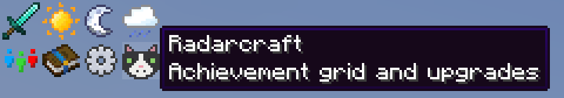
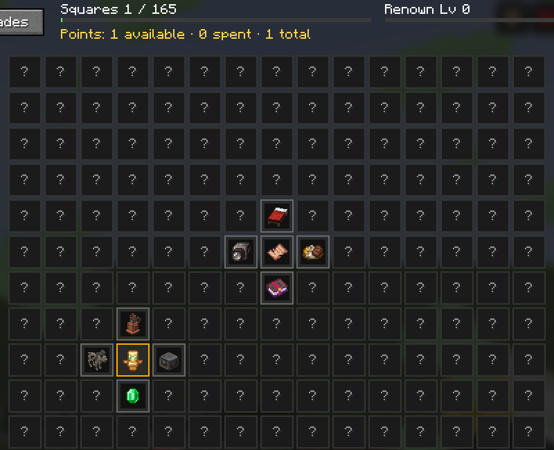
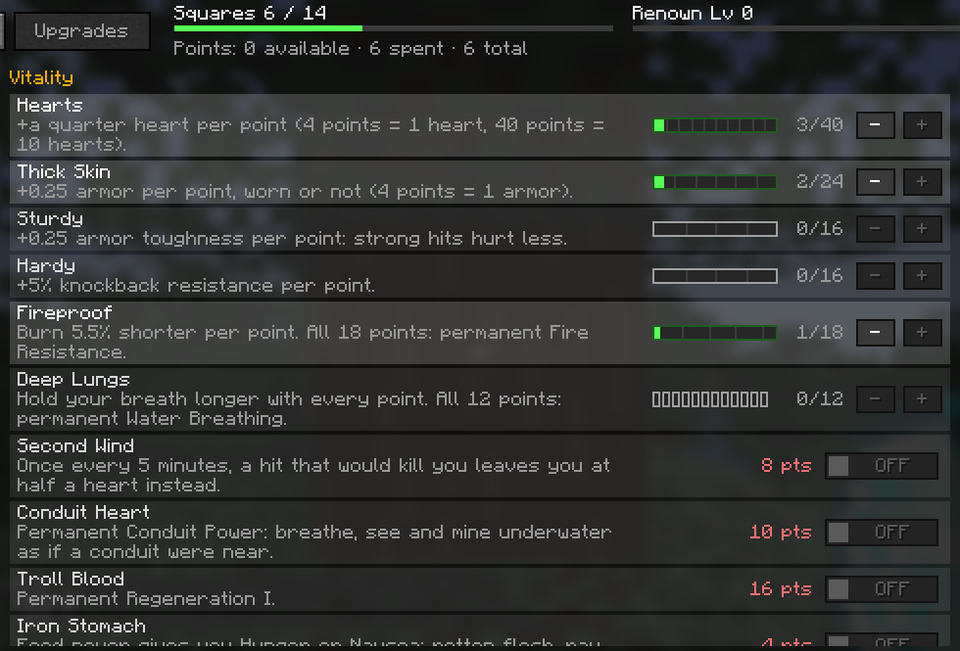
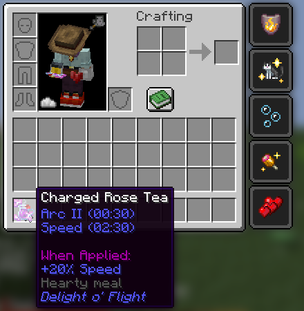
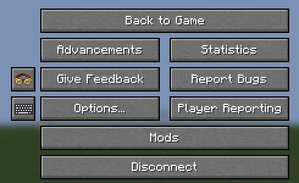
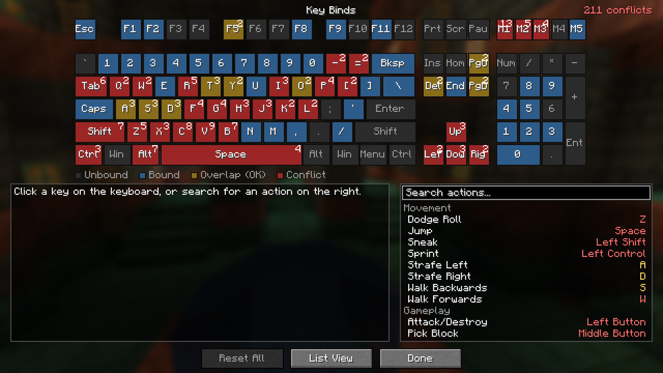
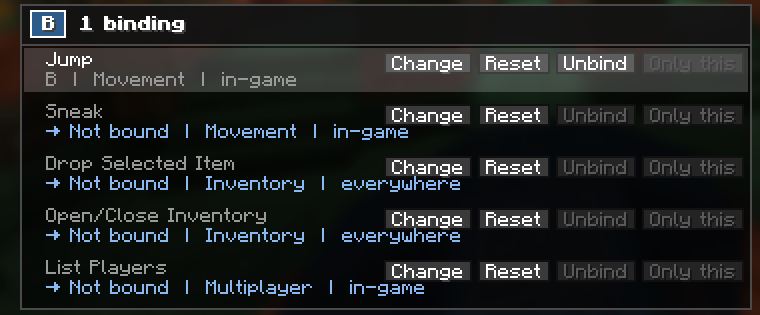
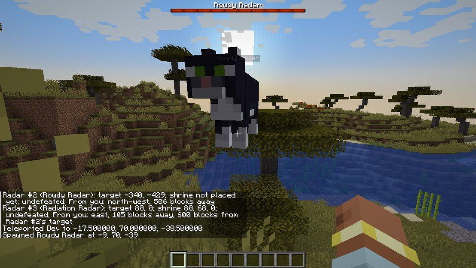
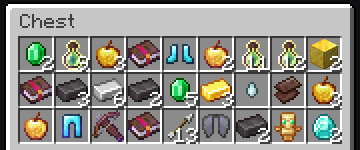

# Radarcraft

A fork of the **Create Aeronautics - Skybound** modpack, plus six mods made for it. Minecraft 1.21.1, NeoForge.
This page is for the people playing on the server. (Developer notes: [docs/DEVELOPMENT.md](docs/DEVELOPMENT.md).)

Radarcraft would not exist without [Create Aeronautics - Skybound](https://www.curseforge.com/minecraft/modpacks/create-aeronautics-skybound)
by **Lupin** (Team LUP), with contributions from Gabriele_333. The mod selection, configs, KubeJS scripts, quests and the
Aetherial Islands worldgen are theirs; this fork trims the list, retunes a few things and adds our own mods on top.
Go download their pack if you want the original.

## Install (Windows, CurseForge app)

1. Install the [CurseForge app](https://www.curseforge.com/download/app) and sign in to Minecraft in it once.
2. Download the pack zip from the [latest release folder](https://github.com/mullens/radarcraft/tree/main/releases/latest)
   (`radarcraft-<version>.zip`, click it, then the Download button).
3. In the CurseForge app: **Minecraft → Create Custom Profile → Import**, pick the zip, wait. It installs NeoForge and
   downloads about 390 mods; give it a few minutes.
4. **Play.** The server is already in your Multiplayer list.

Give the game at least 8 GB of memory (CurseForge app → Settings → Minecraft → Allocated Memory). The first start
takes two to three minutes; later starts are faster.

## Update

Download `Update-Radarcraft.ps1` from the [latest release folder](https://github.com/mullens/radarcraft/tree/main/releases/latest)
(right-click → Save link as on the Raw button), put it anywhere, double-click it. Takes seconds. It:

- removes mods that left the pack and old versions,
- downloads mods that were added or changed, straight from CurseForge,
- refreshes the pack's configs (your own settings, saves and screenshots are untouched).

A couple dozen mods don't allow downloads outside the CurseForge app. If one of *those* changed, the script tells you
which file to grab from its CurseForge page, or you simply import the new zip in the app again (a new profile; nothing is
lost, everything lives on the server).

If double-clicking opens Notepad instead of running: right-click → *Run with PowerShell*. If PowerShell refuses, run
`Set-ExecutionPolicy -Scope CurrentUser RemoteSigned` once in a PowerShell window.

## What's different from Skybound

- **36 mods removed**: Security Craft, the quarry (Additional Enchanted Miner) and the XP obelisk, duplicate storage
  systems, the old skill trees with the hearts, pack-branding menus,
  Punchy, Crafting on a Stick, More Useful Copper, Freeze the Happy Ghasts (no version for the new Vanilla Backport)
  and Visual Workbench (crafting tables hand your items back again when you close them, like vanilla).
- **Added**: Inventory Crafting Grid (3x3 crafting in your inventory), the Accessories Compatibility Layer (one
  accessory screen for everything: Curios trinkets, Aether gloves and pendants, all in the Accessories slots), and the
  six mods below.
- **Newest vanilla content**: Vanilla Backport is updated to 1.2.2, which brings the Copper Age (copper tools and
  armor, copper golem, copper chests, shelves), Mounts of Mayhem, Chase the Skies (happy ghasts) and more to 1.21.1.
- **Rarer loot**: modded chest loot, Artifacts and Simply Swords weapons are harder to find; goblin traders are ~10x rarer.
- **Sky islands, quests, Create and all the Aeronautics addons** are unchanged, and so is the second tech tree:
  Modern Industrialization, Modern Dynamics pipes, Powah, Flux Networks and the wireless chargers.
- **Radarcraft title screen** instead of the Skybound one; JourneyMap comes preconfigured the way Skybound had it;
  the bleed-out/revive mechanic (PlayerRevive) is gone.

## The custom mods

| Mod | What it does for you |
|-----|----------------------|
| **Radarcraft RPG** | Replaces the skill trees. A hidden grid of 165 real achievements from across the pack (bosses, dimensions, exploration, Create feats): each one you complete is a point and reveals the four squares next to it. Achievements you already earned count. More points come from **Renown**, a permanent level that grows with all the XP you earn, slowly, like Minecraft's own levels. Points buy upgrades (hearts, speed, reach, double jump, Second Wind, smelting pickaxe...); big ones cost several points. Take them off again any time, for free. Open it with the **Radar head** (a little tuxedo cat) next to the Quests book in your inventory, the **Radarcraft** button on the Advancements screen, or **M**. |
| **Level Loss Only** | Dying keeps your whole inventory. Your XP levels still drop to zero and spill as orbs, like vanilla. |
| **Cherished Mobs** | Friendly mobs are tough and slowly heal (half a heart every 15 seconds). Anything you name with a name tag can never die, not even in the void. `/kill` is the only way to remove a named mob. |
| **Radars** | Radar is a real tuxedo cat. Name any mob "Radar" with a name tag: it becomes a little tuxedo cat that points toward the first of six giant boss cats hidden across the world, each 500 to 1000 blocks beyond the last. Beat a boss and it turns back into a cat that points to the next one, and leaves a loot chest that gets better with every fight (everyone gets their own roll). |
| **Food Buffs** | Modded food is worth cooking. Every modded dish gives buffs like a potion, themed to what it is (fish lets you breathe underwater, spicy and Nether food gives fire resistance, honey regenerates, coffee speeds up mining, sweets make you quick, meat makes you strong, Aether food floats you, Starlight food lets you see in the dark...), and the harder a dish is to make, the more and longer the buffs: from nothing for a raw tomato up to three buffs for eight minutes. You can eat modded food even when full, but no food can push your saturation above its own value, so snacking can't max it out. Vanilla food works exactly like vanilla. The tooltip shows each dish's buffs and its tier, from Snack to Legendary dish. |
| **Keyboard Keybinds** | A **keyboard icon** right below Create's goggles on the pause menu (Esc) opens a keyboard showing every key. The same view is behind the **Keyboard** button on *Options → Controls → Key Binds*. Red keys are real conflicts, yellow ones are overlaps the game handles fine. Click a key to see everything on it, then Change, Unbind, or keep "Only this" in one click. |

## What it looks like

**Radarcraft RPG.** Click the Radar head next to the Quests book in your inventory:

The grid starts hidden. Every achievement you complete reveals the squares next to it:

Spend points on upgrades. Most give a little per point, so you can spread points out; the big ones are on/off switches:

**Food Buffs.** The tooltip shows what a dish does and how hard it is to make:

**Keyboard Keybinds.** The keyboard icon below Create's goggles in the pause menu opens the keyboard view:

Red keys have real conflicts. Click one to fix everything on it in one place:

**Radars.** A boss cat, and the loot chest it leaves behind:

## Before the server switches to Radarcraft

A few mods are gone, and whatever they stored goes with them. Before the update day:

- **Empty your crafting tables.** Items left lying in a crafting table disappear when Visual Workbench is removed.
- **Empty and break machines from removed mods**: Tom's Simple Storage, Security Craft blocks, Additional Enchanted
  Miner quarries, Experience Obelisks, Nether Chested and wider ender chests, Super Ore Blocks. Their blocks turn into air.
- **Curios trinkets are safe**: everything you wear moves into the Accessories screen by itself.
- **Your old skill points are not**: the Pufferfish skill trees are gone; Radarcraft RPG starts you with points for
  the achievements you already have plus Renown from your current XP.

## Server

The server runs the same mod list minus client-only mods (shaders, animations, menus). The server admin updates it; don't
expect your client changes to matter there. If you get a "mod mismatch" screen when joining, run the updater first.

## Trouble

- **Game won't start, or crashes right away**: run the updater, then try again. One mod (Architectury) occasionally
  crashes during startup on the first attempt; a second launch usually works.
- **"Incompatible client" when joining**: your pack is out of date, run the updater (or re-import the newest zip).
- **Something else**: send the admin `logs/latest.log` from your profile folder
  (`%USERPROFILE%\curseforge\minecraft\Instances\<profile>\logs`).
